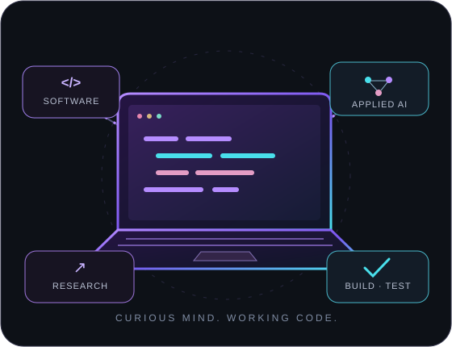
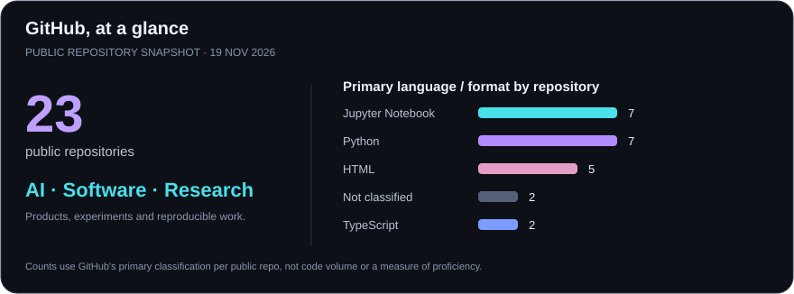

<h1 align="center">Hi, I'm Ajay Sai Kummara 👋</h1>

<strong>Software Engineering · Applied AI · Research</strong>

I build AI products, test them with people, and investigate how to make their behaviour more reliable.

  
  
  

---

### About me

- 🎓 **MSc Artificial Intelligence, Queen's University Belfast** — dissertation awarded **Distinction (71%)**.
- 🚀 Building **[FounderRadar](https://founderradar-10.vercel.app/)**, an open-beta product for evidence-led idea validation, prospect discovery and customer outreach.
- 🔬 Research interests: **agent evaluation, runtime policy identification and secure code generation**.
- 🧪 I care about reproducible experiments, clear failure cases and learning from real users.
- 🎤 I pitch, run customer discovery and explain technical ideas through **[Instagram](https://www.instagram.com/aj.s.ai/)**.
- 📍 Belfast, UK · Open to **graduate software engineering, AI engineering and research engineering opportunities across the UK**.

 

### Tech stack

**Languages & databases**  

**AI & data**  

**Products & engineering tools**  

**Cloud learning:** AWS Academy / AICTE–EduSkills AI/ML virtual internship, including applied machine learning with Amazon SageMaker.

### Explore my work

| Project | What you'll find | Links |
| :--- | :--- | :--- |
| **FounderRadar** | React / TypeScript / Supabase product connecting source-backed problem evidence with prospect discovery and validation sprints. Iterated through pilot feedback and customer discovery. | [Code](https://github.com/AJaysAIk/founderradar-10) · [Live beta](https://founderradar-10.vercel.app/) |
| **A-IPES** | MSc research on adaptive intervention planning for runtime policy identification. Reproducible Python benchmarks, baselines and ablation studies. | [Research & code](https://github.com/AJaysAIk/A-IPES) |
| **Code Agent Security Eval** | Small defensive evaluation harness for secure-code review: reproducible fixtures, Semgrep, structured reports and CI. Current LLM baseline uses a deterministic mock. | [Code & methodology](https://github.com/AJaysAIk/code-agent-security-eval) |
| **ClarityX1** | Earlier NLP and Telegram chatbot project exploring text classification and conversational interaction. | [Code](https://github.com/AJaysAIk/AI-Telegram-chatbot--Clarity-x1) |
| **Methylation data research** | Preprocessing and unsupervised subtype discovery in high-dimensional biological data. | [Notebooks](https://github.com/AJaysAIk/Robust-Preprocessing-and-Unsupervised-Subtype-Discovery-in-High-Dimensional-Methylation-Data) |
| **Portfolio** | Interactive demos, project stories, research and evidence in one place. | [Code](https://github.com/AJaysAIk/Portfolio) · [Explore](https://portfolio-three-tau-6ojtkra7p2.vercel.app/) |

### Beyond the code

- **QueFlex:** contributed to a team prototype built with Lovable, React / TypeScript and Supabase. **Runner-up, Matrix NI's Hack to the Future**; featured in **[The News Letter](https://www.newsletter.co.uk/business/team-with-a-vision-for-the-future-win-matrix-ni-hackathon-5616091)**.
- **Imperial College AI Agent Hackathon:** category prize.
- **Queen's Business School Hackathon:** Most Ambitious award.
- **Berkeley Method Entrepreneurship Bootcamp:** second prize.
- Completed the **QUest × Techstars Customer Discovery Sprint**, testing FounderRadar's assumptions through customer discovery; pitched at **Pitch n' Pint, Catalyst Belfast**.

### GitHub analytics

A dated snapshot of public repositories. [Source and method](./data/public-repositories.json). GitHub's live contribution graph appears below this README.

---

<strong>Building something useful with AI, or evaluating how it can fail?</strong> 
I'd love to compare notes, contribute to a project, or discuss an engineering opportunity.  
<a href="https://portfolio-three-tau-6ojtkra7p2.vercel.app/">Explore my portfolio</a> ·
<a href="https://www.linkedin.com/in/ajay-kummara">Let's connect</a> ·
<a href="mailto:akummara01@qub.ac.uk">Get in touch</a>

